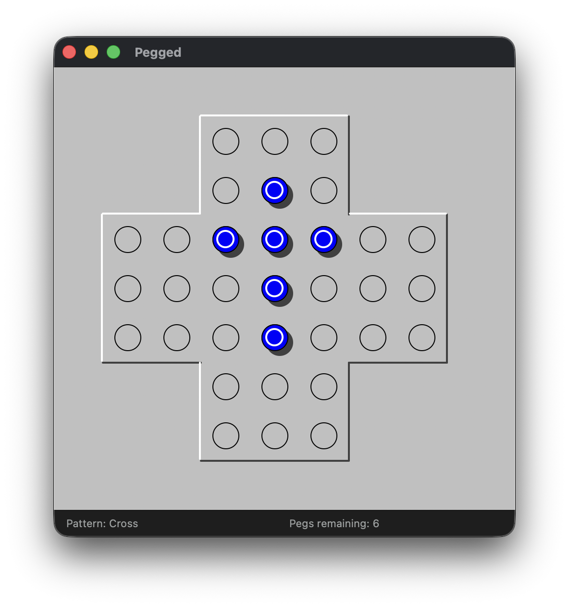
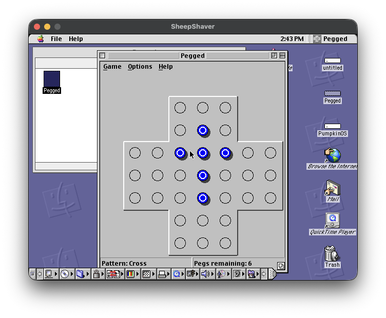
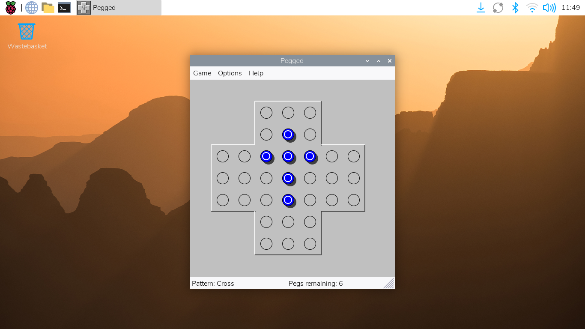
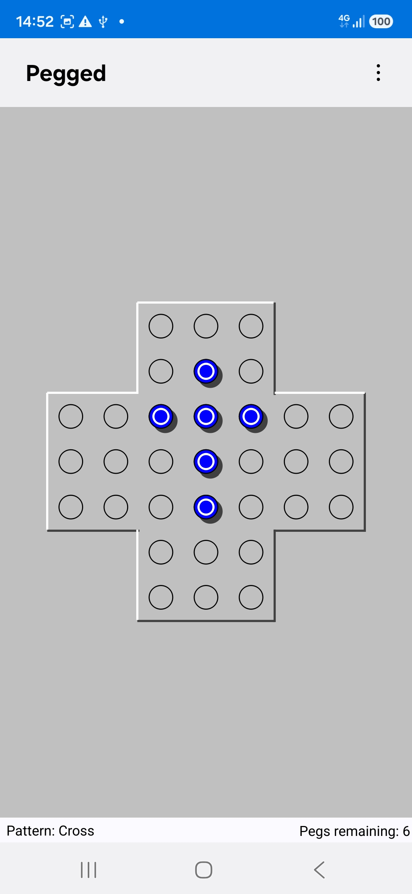
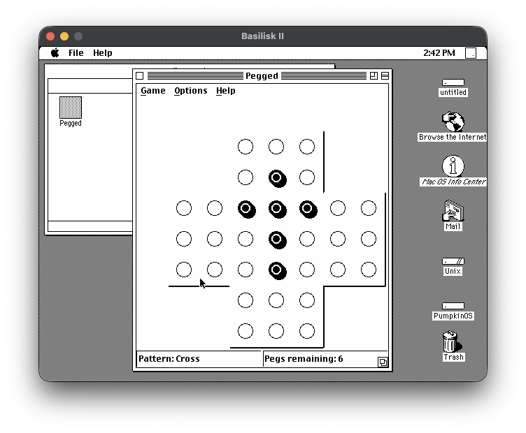

# wxpegged

A portable [wxWidgets](https://www.wxwidgets.org/) port of **Pegged**, the
peg-solitaire game from the *Microsoft Entertainment Pack* (original Win32
game © Mike Blaylock, 1989–1990).

The port preserves the original game logic but replaces the Win32 GDI
bitmap caching with wxWidgets' portable buffered drawing, so it builds
and runs unchanged on Linux (GTK), macOS (Cocoa), and Windows (MSW).

## Screenshots

- Windows:


- macOS:



- Mac OS 7.5.X (m68k)


- Mac OS 9.X (ppc)



- Linux:



- Android:



- Classic Mac OS (68k, System 7):



## How to play

Drag a peg over an adjacent peg and drop it into the empty hole on the
far side. The jumped peg is removed. Jumps must be horizontal or vertical
(no diagonals). Pick a starting pattern from the **Options** menu; on
the Solitaire pattern, the goal is to leave a single peg in the centre.

Patterns available: Cross, Plus, Fireplace, Up Arrow, Pyramid, Diamond,
Solitaire.

Keyboard shortcuts:

| Key      | Action     |
| -------- | ---------- |
| `F1`     | How to play |
| `F2`     | New game    |
| `Ctrl+Z` / `Backspace` | Undo (backup) |
| `Alt+F4` | Exit        |

## Requirements

- A C++17 compiler (clang, gcc, or MSVC)
- wxWidgets 3.x (`core` and `base` components)
  - Debian/Ubuntu: `sudo apt install libwxgtk3.2-dev`
  - Fedora: `sudo dnf install wxGTK-devel`
  - macOS (Homebrew): `brew install wxwidgets`
  - Windows: prebuilt binaries or vcpkg (`vcpkg install wxwidgets`)

## Building

### CMake (recommended, all platforms)

```sh
cmake -B build
cmake --build build
```

Install (Linux):

```sh
sudo cmake --install build
```

This installs the binary to `bin/`, the `.desktop` file to
`share/applications/`, the AppStream metainfo to `share/metainfo/`, and
the hicolor PNG icon set under `share/icons/hicolor/`.

On macOS, CMake produces `wxpegged.app` with `pegged.icns` wired in via
`MACOSX_BUNDLE_ICON_FILE`. On Windows, `pegged.rc` compiles in the
version info and `pegged.ico`.

### Classic Mac OS (Retro68, 68k + PowerPC)

Built with the [Retro68](https://github.com/autc04/Retro68) toolchain
(installed in `/opt/retro68`) and its wxRetro68 port of wxWidgets:

```sh
retro68/build.sh            # or: RETRO68=/path/to/retro68 retro68/build.sh out-dir
```

This builds the 68k and PowerPC applications and merges them into a single
fat (universal) application, `build-retro68/Pegged.dsk` (an HFS disk image
for Basilisk II, SheepShaver, QEMU or a real Mac) and
`build-retro68/Pegged.bin` (MacBinary). The single-architecture builds are
in `build-retro68/m68k` and `build-retro68/ppc`. It needs System 7 or later
with 32-bit QuickDraw. The window is sized to fit the screen (down to
512x342), and Help shows the help pages in a window of its own. The classic
Mac icons in `retro68/icons.r` are generated from `sizes/` by
`retro68/make-icons.py`.

To test unattended in Basilisk II, build with tracing and run it from a copy
of a System 7/8 boot disk (`BOOT_DISK`, default `~/MacROM/HD.img`; the
original is not modified):

```sh
WXPEGGED_CMAKE_ARGS=-DWXPEGGED_TRACE=ON retro68/build.sh build-trace
retro68/run-basilisk.sh build-trace/Pegged.bin
```

The trace build logs its startup to `wxtest.log` and shuts the Mac down 25
seconds after its window appears; the script prints the log and keeps
screenshots in its work directory.

### GNU make (Unix / macOS / MSYS2)

Requires `wx-config` on `PATH`:

```sh
make -f GNUmakefile.wx
make -f GNUmakefile.wx run
make -f GNUmakefile.wx clean
```

## Layout

```
wxpegged.cpp          single-file wxWidgets source
CMakeLists.txt        CMake build (all platforms)
GNUmakefile.wx        make-based build for Unix/macOS/MSYS2
pegged.rc             Windows resource script (icon + version info)
pegged.manifest       Windows side-by-side manifest
common.ver            shared VERSIONINFO definitions
pegged.ico            Windows icon
pegged.icns           macOS icon
pegged.iconset/       source PNGs for pegged.icns
sizes/<NxN>/apps/     hicolor PNG icons installed on Linux
wxpegged.desktop      XDG desktop entry
wxpegged.metainfo.xml AppStream metadata
retro68/              classic Mac OS (Retro68) build: build.sh, resources,
                      help window, icon generator, emulator test scripts
cmake/                Retro68 application packaging (CMake)
bin2c.c               embeds the help pages in the classic Mac OS build
```

The app icon is loaded at runtime by `LoadAppIcons()` in `wxpegged.cpp`,
which searches the executable's directory, the macOS bundle's
`Resources`, and `/usr/(local/)share/icons/hicolor/*/apps/` for any
installed PNG sizes, and falls back to `pegged.ico` / `pegged.icns` next
to the binary. On Windows the icon embedded via `pegged.rc` is also
picked up through `SetIcon(wxIcon("100"))`.

## License

Source code is distributed under the GPL-2.0 (see
`wxpegged.metainfo.xml`). The original Pegged game is © Mike Blaylock,
1989–1990.
